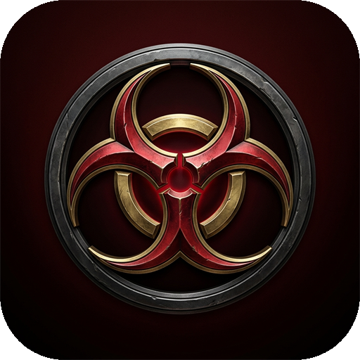

<p align="center">
  
</p>

<h1 align="center">RE Outbreak Desktop</h1>

<p align="center">
  Standalone desktop client for <a href="https://outbreakweb.com/">Outbreak·Web</a> (Resident Evil Outbreak File #1 &amp; File #2).<br>
  <b>English</b> · <a href="README.es.md">Español</a>
</p>

<p align="center">
  <a href="https://github.com/DJTOMATO/reoutbreakdesktop/releases"><b>Download Latest Installer (Releases)</b></a> ·
  <a href="https://outbreakweb.com/">Website</a> ·
  <a href="https://github.com/DJTOMATO/reoutbreakdesktop/issues">Report an Issue</a>
</p>

---

## Why a desktop client?

[Outbreak·Web](https://outbreakweb.com/) runs Resident Evil Outbreak (File #1 and File #2) directly in the browser using a static PS2 WebAssembly recompiler (`ps2-web-recomp`) and WebGPU. While it works in regular browsers, normal browser tabs have a few annoying habits when you are playing an online match:

- **Alt-tabbing throttles the game:** Standard browsers slow down background tabs, which can stall the emulator and drop your online `NETWORK PLAY` session if you tab out to check Discord or a guide.
- **Integrated vs. discrete GPU:** Laptops often default the browser to integrated graphics instead of your dedicated NVIDIA/AMD card.
- **Screen sleep on controller:** Playing on a gamepad without touching the mouse or keyboard can trigger Windows screen sleep mid-scenario.
- **Accidental shortcuts:** Browser keybinds can get in the way of game inputs.

This client wraps `outbreakweb.com` in a stripped-down Electron 45 build with all the necessary Chromium/V8 flags pre-configured for hardware rendering and online play.

## Download & Install

Grab the latest `Outbreak Web Setup.exe` installer from the [**Releases page**](https://github.com/DJTOMATO/reoutbreakdesktop/releases).

## What's configured under the hood

- **Forced High-Performance GPU:** Passes `force_high_performance_gpu`, `ignore-gpu-blocklist`, `enable-unsafe-webgpu`, `enable-gpu-rasterization`, `enable-zero-copy`, and `enable-oop-rasterization` so Dawn/WebGPU uses your dedicated GPU with zero-copy frame presentation.
- **No Background Throttling:** Disables renderer backgrounding and timer throttling (`disable-renderer-backgrounding`, `disable-background-timer-throttling`, `disable-backgrounding-occluded-windows`, `backgroundThrottling: false`). You can alt-tab without dropping out of online rooms.
- **Full WebAssembly Feature Set:** Ships with Chromium 146 / V8 support for WebAssembly JSPI (`WebAssembly.Suspending`), `try_table` exception handling, tail calls, SIMD, and COOP/COEP cross-origin isolation.
- **1 GB Local Disk Cache:** Keeps the ~28 MB engine binary and streamed 64 MB disc chunks cached locally so subsequent launches load fast.
- **Persistent Memory Cards:** Your virtual 8 MB PS2 memory cards (IndexedDB), player name, online token, and control bindings are stored in your local user profile. You can still export/import `.ps2` memory card files from the side panel at any time.
- **Gamepad & Rumble Support:** Works out of the box with XInput and DualShock/DualSense controllers, including dual-motor vibration and a display sleep blocker while the app is open.

## System Requirements / Specs

| Component | Minimum | Recommended (2x / 3x Internal Scale) |
| :--- | :--- | :--- |
| **OS** | Windows 10 (64-bit, 1909+) | Windows 10 / 11 (64-bit) |
| **CPU** | 4-core x86_64 processor | Modern 6+ core CPU (Ryzen 5 / Core i5 or better) |
| **GPU** | DirectX 12 / Vulkan capable GPU with WebGPU support | Dedicated NVIDIA (GTX 1060 / RTX series) or AMD (RX 580 / RX 6000+) |
| **RAM** | 4 GB | 8 GB+ |
| **Storage** | ~300 MB for the client + up to 1 GB cache | SSD with 1.5 GB free space |
| **Network** | Broadband connection (streams disc chunks on demand) | Stable broadband for `NETWORK PLAY` rooms |

## Shortcuts

| Key | Action |
| :--- | :--- |
| `F` | Toggle in-game fullscreen |
| `F11` / `Alt + Enter` | Toggle native window fullscreen |
| `F1` | Show in-game controls reference |
| `F5` / `Ctrl + R` | Reload page |
| `F12` / `Ctrl + Shift + I` | Toggle DevTools |
| `Esc` | Exit fullscreen / close dialogs |

## Building from Source

You need [Node.js](https://nodejs.org/) (v20+ recommended) and npm installed.

```bash
git clone https://github.com/DJTOMATO/reoutbreakdesktop.git
cd reoutbreakdesktop
npm install
```

To run the client in development mode:

```bash
npm start
```

To build the Windows NSIS installer (outputs to `dist/`):

```bash
npm run build
```

## Disclaimer

This is an unofficial community desktop wrapper for [outbreakweb.com](https://outbreakweb.com/). It is not affiliated with or endorsed by Capcom. *Resident Evil* and *Resident Evil Outbreak* are trademarks of Capcom Co., Ltd. No game ROMs, BIOS files, or copyrighted assets are included in this repository.
